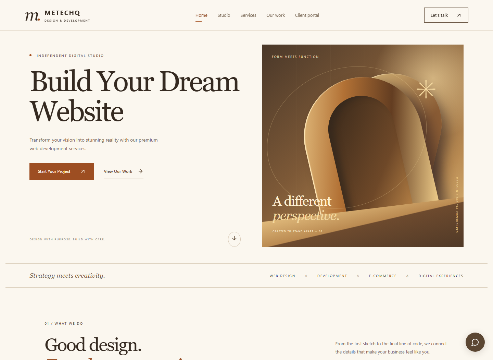
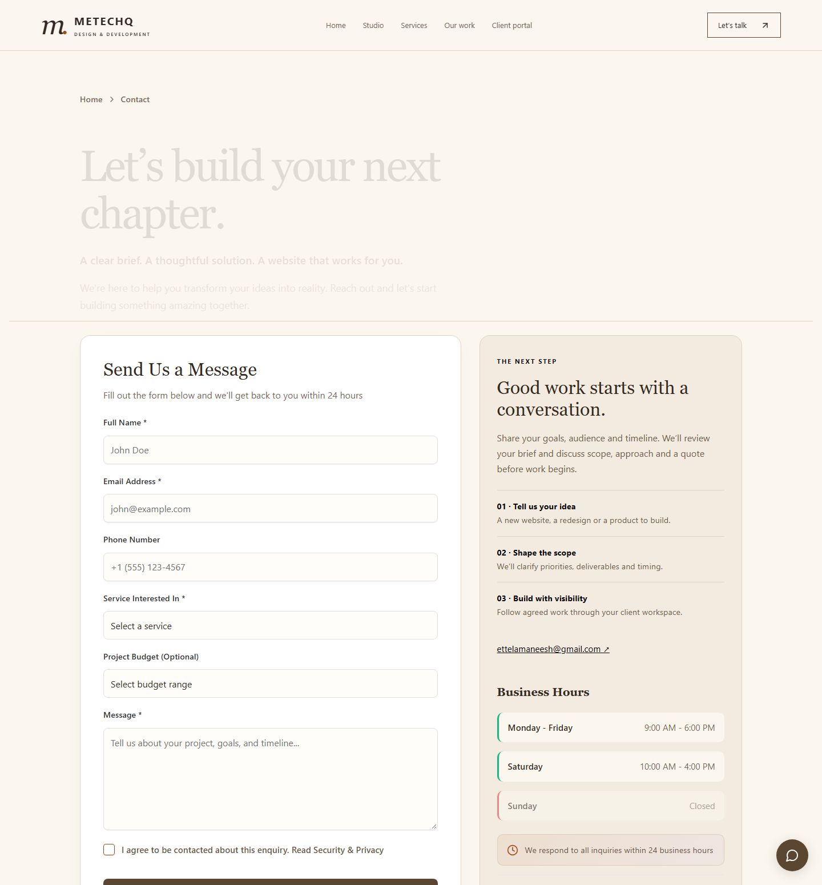
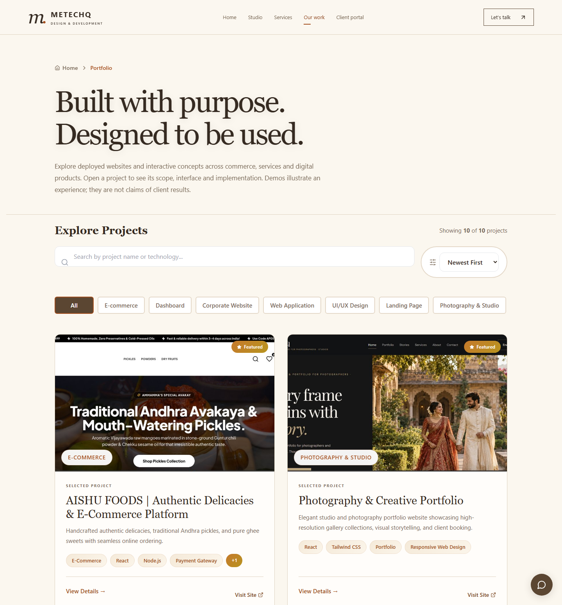
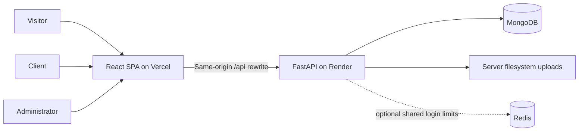

<div align="center">

# METECHQ

### From first impression to project delivery.

A digital-agency platform connecting a public showcase, a client workspace, and an administrator suite.

[](https://github.com/mani1715/Metechq/actions/workflows/ci.yml)


**[Explore the website](https://frontend-iota-mauve-57.vercel.app) · [API documentation](https://metechq.onrender.com/docs) · [Security & Privacy](https://frontend-iota-mauve-57.vercel.app/security) · [Evaluator guide](docs/EVALUATION_GUIDE.md)**

</div>



> Product previews captured from the local application. The deployment links above are the configured destinations; production has not been reverified for this revision.

## One platform, three connected experiences

METECHQ brings the work of a digital studio into one application: explain the offering, collect a project enquiry, manage delivery, and give the client visibility into progress. The public site and authenticated workspaces share a React frontend and a FastAPI API backed by MongoDB.

| Experience | What is implemented | Where to look |
|---|---|---|
| **Discover** | Services, searchable portfolio, project detail pages, industry demos, blogs, testimonials, newsletter, enquiries, pricing estimates and bookings | [Public routes](frontend/src/App.js) · [Portfolio](frontend/src/pages/PortfolioNew.jsx) |
| **Collaborate** | Client login, assigned projects, progress, milestones, tasks, files, comments and project chat | [Client workspace](frontend/src/pages/ClientDashboard.jsx) · [Scoped API](backend/routes/client_projects.py) |
| **Operate** | Content and portfolio management, enquiries, clients, projects, bookings, newsletter, settings and permission-controlled administration | [Admin suite](frontend/src/admin) · [Admin routes](backend/routes) |
| **Inspect** | Restricted Security Center with recorded evidence, audit-chain checks and dependency information | [Security Center](frontend/src/admin/pages/SecurityCenter.jsx) · [Server checks](backend/routes/admins.py) |

The industry demos are **interactive concepts**. For example, the commerce demo has cart and checkout UI, but simulates order placement; it does not process payments. External portfolio sites are separate deployments whose implementation is not contained in this repository.

## A closer look

| A clear first conversation | Work presented with context |
|---|---|
|  |  |
| A project brief becomes an admin-visible enquiry. Budget and permission to contact are retained with the message. | Browse projects, inspect the implementation, and follow the studio credit to learn about METECHQ. |

[Mobile enquiry preview](docs/images/contact-mobile.png) · [Mobile portfolio preview](docs/images/portfolio-mobile.png)

## Engineering behind the experience

- **A complete enquiry path:** React form → validated API payload → MongoDB → permission-controlled admin inbox, including read/unread management. [Implementation](backend/routes/contacts.py) · [Round-trip regression](tests/backend/test_evaluation_security.py)
- **Separate authentication realms:** admin and client tokens have distinct signing configuration and request routing. [JWT implementation](backend/auth/jwt.py) · [Frontend request handling](frontend/src/services/api.js)
- **Server-owned authorization:** client project endpoints constrain access by the authenticated client, rather than trusting a project ID supplied by the browser. [Implementation](backend/routes/client_projects.py)
- **A maintainable public catalogue:** API-backed projects, cached initial rendering, URL validation, search, category/technology filters, pagination and explicit unavailable-image states. [Service](frontend/src/services/projectService.js) · [URL tests](frontend/src/utils/projectUrls.test.js)
- **Repeatable evaluation:** an isolated test runner creates a disposable database and exercises API, authorization, upload and workspace flows. [Runner](scripts/run_evaluation_tests.py)

## Architecture



This describes the repository's deployment configuration, not a live infrastructure attestation. [Vercel routing](frontend/vercel.json) proxies `/api` to the configured Render backend; local development calls the API directly. MongoDB stores application records and file metadata. Uploaded bytes live under `UPLOAD_DIR` and are served through authorized download routes. Production needs persistent storage for those files; the code does not provide managed object storage. [Storage implementation](backend/routes/storage.py) · [Deployment guide](docs/deployment/DEPLOYMENT_GUIDE.md)

| Layer | Implementation |
|---|---|
| Frontend | React 18, React Router 6, JavaScript/JSX, Tailwind CSS, Radix UI, Lucide, Axios |
| Backend | Python, FastAPI, Pydantic, Uvicorn, JWT authentication |
| Data | MongoDB with Motor; local filesystem uploads |
| Infrastructure | Vercel SPA rewrites, Render API configuration, Docker/Compose, optional Redis |
| Verification | Jest/React test utilities, pytest, HTTP integration suites, GitHub Actions, dependency baseline checks, Gitleaks |

Versions and dependencies are defined in [frontend/package.json](frontend/package.json), [yarn.lock](frontend/yarn.lock), and [backend/requirements.txt](backend/requirements.txt).

## Security: controls with boundaries

| Confirmed in code | Evidence | Scope / limitation |
|---|---|---|
| Admin/client realm separation and client project scoping | [Security regression suite](tests/backend/test_evaluation_security.py) | Automated local tests; not a claim of a current production penetration test. |
| Upload extension, signature, size and path validation | [Validation](backend/utils/file_security.py) · [Tests](tests/backend/test_evaluation_security.py) | Validation is not malware scanning. |
| Login rate limiting | [Limiter](backend/utils/rate_limiter.py) · [Concurrency tests](tests/backend/test_comprehensive_security.py) | Without Redis, state is process-local and not shared across workers. |
| API and frontend response-header configuration | [API middleware](backend/server.py) · [Vercel headers](frontend/vercel.json) | Hosted enforcement must be checked after deployment with the [hosted verifier](scripts/verify_hosted_headers.py). |
| Security audit events and SHA-256 chain verification | [Audit implementation](backend/utils/audit_logger.py) · [Tamper tests](tests/backend/test_evaluation_security.py) | Unkeyed hashing detects inconsistencies; a privileged database actor can rewrite and recompute the chain. |

**Known limitations:** browser tokens are stored in `localStorage` and are exposed to successful same-origin script execution. Dependency advisories remain documented; baseline checks do **not** mean a clean dependency audit. See the [threat model](THREATS.md), [security setup](SECURITY_SETUP.md), and [verification evidence](docs/verification/README.md) for scope and recorded findings. Historic audit reports describe earlier revisions and should not be read as current live certification.

## Run locally

Use the [local setup guide](docs/LOCAL_SETUP.md) for prerequisites, platform-specific commands, environment configuration and troubleshooting. Start MongoDB locally, install the backend requirements into a Python virtual environment, and install frontend dependencies with `yarn install --frozen-lockfile`.

With the environment templates configured, start two terminals:

```sh
# Terminal 1 — activated Python environment, from repository root
cd backend
python -m uvicorn server:app --reload --host 127.0.0.1 --port 8002
```

```sh
# Terminal 2 — from repository root
cd frontend
yarn start
```

The frontend template sets **http://localhost:3003**. API documentation is at **http://127.0.0.1:8002/docs**. Do not use production credentials or client data for evaluation.

## Verification and CI

Run from the repository root, with MongoDB available for the backend suite:

```sh
python scripts/run_evaluation_tests.py
cd frontend
yarn test --watchAll=false --runInBand
yarn build
```

**Local results — 9 November 2026:** 73 pytest checks, 37 API checks, 12 client-management checks and 20 frontend tests passed; the production bundle compiled successfully. The browser review exercised public routes, responsive contact/portfolio layouts and an enquiry submitted through the UI and retrieved in the admin inbox. See [this revision's verification report](docs/verification/SHOWCASE_REVIEW.md) for the exact scope and remaining gaps.

[GitHub Actions](https://github.com/mani1715/Metechq/actions/workflows/ci.yml) defines separate history secret scanning, backend evaluation/dependency-baseline, and frontend test/build jobs. The badge reports GitHub's workflow state; local results above are not a claim that this revision passed hosted CI. Current production behavior remains unverified.

## Documentation map

| Start here | Go deeper |
|---|---|
| [Evaluator walkthrough](docs/EVALUATION_GUIDE.md) | [Feature inventory](docs/FEATURE_INVENTORY.md) |
| [Local development](docs/LOCAL_SETUP.md) | [Architecture notes](ARCHITECTURE_SUMMARY.md) |
| [Portfolio and client guide](docs/PORTFOLIO_AND_CLIENT_GUIDE.md) | [Deployment guide](docs/deployment/DEPLOYMENT_GUIDE.md) |
| [Threat model](THREATS.md) | [Security configuration](SECURITY_SETUP.md) |
| [Verification evidence](docs/verification/README.md) | [Current showcase review](docs/verification/SHOWCASE_REVIEW.md) |
| [Prompt history](PROMPTS.md) | [AI work history](docs/AI_WORK_HISTORY.md) |

## AI-assisted development

AI assistance has supported code review, implementation, debugging and documentation. [PROMPTS.md](PROMPTS.md) records the requests and [AI work history](docs/AI_WORK_HISTORY.md) provides context. Generated changes are supported by the stated checks; AI assistance itself is not verification or a security guarantee.

## Next improvements

Open work includes reducing dependency advisories, replacing the legacy CRA build toolchain, improving session storage beyond `localStorage`, and stronger external anchoring for audit records. Production file durability and hosted verification depend on deployment configuration. These limitations are detailed in [THREATS.md](THREATS.md) and [SECURITY_SETUP.md](SECURITY_SETUP.md).

---

**METECHQ · Design & development**
Project enquiries and support: [ettelamaneesh@gmail.com](mailto:ettelamaneesh@gmail.com)
