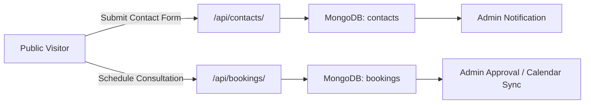
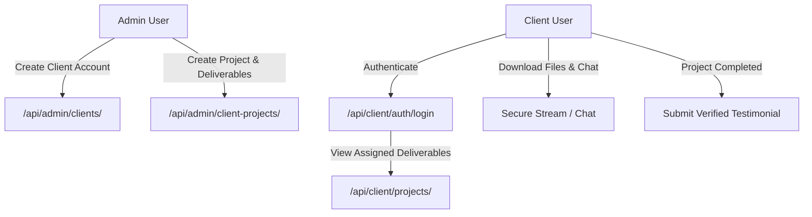

# Metechq Platform — Feature Inventory & User Roles

**Date**: November 6, 2026  
**Application**: Metechq Full-Stack Digital Agency Platform  

---

## 1. User Roles & Permission Hierarchy

The platform implements four principal user personas:

| Role | Access Scope | Authentication Mechanism | Primary Capabilities |
| :--- | :--- | :--- | :--- |
| **Public Visitor** | Public Website & Demos | Anonymous / Ephemeral Session | Browse portfolio, services, blogs, submit contact requests, initiate customer chat, book consultations, explore 10 interactive industry demos. |
| **Client** | Client Portal (`/client/*`) | JWT Bearer (`client_token`, type: `client`) | Track assigned deliverables, milestones, tasks, budget status, upload/download project documents, exchange live chat messages with project managers, submit reviews for completed projects. |
| **Standard Admin** | Admin Console (`/admin/*`) | JWT Bearer (`admin_token`, role: `admin`) | Manage assigned CMS sections, review contact submissions, respond to customer chats, update client projects, and manage assigned deliverables subject to granular boolean permission flags. |
| **Super Admin** | Admin Console (`/admin/*`) | JWT Bearer (`admin_token`, role: `super_admin`) | Full administrative bypass; provision/delete admin accounts, configure system credentials, configure booking parameters, export subscriber lists, manage global pricing and agency branding. |

### Granular Admin Permission Flags (`AdminPermissions`)
- `canManageAdmins`: Provision and edit subordinate admin users.
- `canManageAbout`: Edit agency story, team members, achievements, and core values.
- `canManagePortfolio`: Create, update, publish, or archive public portfolio projects.
- `canManageBlogs`: Author, publish, and delete blog articles.
- `canManageTestimonials`: Review, approve, feature, or delete client testimonials.
- `canManageDemos`: Configure and toggle live demo links and showcases.
- `canViewContacts`: View inbound contact submissions.
- `canManageContactPage`: Edit contact information, business hours, and map settings.
- `canManageChat`: Access customer conversations and reply to incoming inquiries.
- `canManageNewsletter`: View and export email subscriber lists.
- `canManageBookings`: Approve, reschedule, or cancel client consultation bookings.
- `canManageBookingSettings`: Modify booking schedules, slot durations, and working hours.
- `canManagePricing`: Update service rate cards and package pricing.
- `canViewAnalytics`: View traffic analytics, page views, and calculator conversions.
- `canManageClients`: Create client accounts, reset passwords, activate/deactivate accounts.
- `canManageClientProjects`: Create projects, set budgets, define milestones, assign tasks.
- `canAccessStorage`: Upload and view agency media, documents, and assets.
- `canManageNotes`: Create and search administrative scratchpad notes.
- `canManageSettings`: Update agency identity, logo, theme, and social handles.
- `canViewPrivateProjects`: View internal non-public projects.
- `canViewCredentials`: View masked system environment credentials.
- `canEditCredentials`: Add, modify, or sync system environment credentials.

---

## 2. Frontend Page & Feature Matrix

### 2.1 Public Pages
| Route | Component | Key Features & Interactions |
| :--- | :--- | :--- |
| `/` | `Home.jsx` | Dynamic hero banner, feature highlights, service teasers, interactive pricing calculator, featured portfolio showcase, customer testimonials, contact teaser, floating chat widget. |
| `/about` | `About.jsx` | Company story, founding mission, timeline milestones, core values, leadership team profiles, dynamic achievement stats. |
| `/services` | `Services.jsx` | Comprehensive service catalog with price ranges, deliverables, feature checklists, and consultation call-to-action. |
| `/portfolio` | `PortfolioNew.jsx` | Filterable project gallery by category (E-commerce, SaaS, Hospitality, Education, Corporate), live demo launch buttons, tech stack badges. |
| `/portfolio/:id` | `PortfolioItemPage.jsx` | Deep-dive project case study, challenge/solution analysis, gallery carousel, client metadata, key features, and live demo link. |
| `/contact` | `Contact.jsx` | Inbound lead generation form with name, email, phone, subject, message, direct WhatsApp link, business hours, office location map. |
| `/chat` | `Chat.jsx` | Dedicated full-page live customer chat widget for direct communication with the support team. |
| `/blogs` | `BlogList.jsx` | Article catalog with search, category filtering, featured articles, reading time estimates, and author attribution. |
| `/blogs/:slug` | `BlogDetail.jsx` | Full article reader with markdown rendering, table of contents, tags, and share buttons. |
| `/submit-testimonial` | `SubmitTestimonial.jsx` | Public submission form for client feedback and star ratings. |

### 2.2 Client Portal
| Route | Component | Key Features & Interactions |
| :--- | :--- | :--- |
| `/client/login` | `ClientLogin.jsx` | Secure client authentication via email and password; stores JWT token and redirects to dashboard. |
| `/client/dashboard` | `ClientDashboard.jsx` | Multi-project dashboard with tabbed navigation: Project Overview, Milestones & Progress, Task Checklist, Budget & Invoicing status, Deliverable Files (secure downloads), Real-Time Chat with team, Activity Timeline, and Testimonial Submission. |

### 2.3 Interactive Industry Demos
The platform incorporates 10 live, self-contained functional demos:
1. `/demo/ecommerce`: E-commerce store with product catalog, cart, and simulated Stripe checkout.
2. `/demo/corporate`: Corporate enterprise landing page with team profiles and services.
3. `/demo/mobile-design`: Mobile-first responsive UI system and component showcase.
4. `/demo/restaurant-booking`: Online restaurant table reservation system with real-time slot selection.
5. `/demo/hospitality`: Hotel and resort booking experience with amenity exploration.
6. `/demo/saas-landing`: Conversion-focused SaaS product landing page with pricing matrix.
7. `/demo/social-media`: Social media management workflow and marketing agency showcase.
8. `/demo/analytics`: Interactive metrics visualization dashboard with XY charts.
9. `/demo/lms`: Learning management system with course catalog, curriculum, and lessons.
10. `/demo/real-estate`: Property listings, search filters, and property detail pages.

### 2.4 Admin Console (`/admin/*`)
| Route | Component | Admin Capabilities |
| :--- | :--- | :--- |
| `/admin/login` | `Login.jsx` | Administrative authentication (supports username or email). |
| `/admin` or `/admin/dashboard` | `Dashboard.jsx` | Overview KPIs, recent inquiries, unread chats, project delivery statuses, quick actions. |
| `/admin/clients` | `ClientsManager.jsx` | Client directory, client onboarding, password management, account activation. |
| `/admin/client-projects` | `ClientProjectsManager.jsx` | End-to-end client project administration, milestones, tasks, team allocation, budget tracking, deliverable file uploads, and direct chat. |
| `/admin/portfolio` | `PortfolioManager.jsx` | Portfolio project CRUD, slug generator, image upload, tech stack tagging. |
| `/admin/services` | `ServicesManager.jsx` | Service offerings, feature lists, pricing ranges, display ordering. |
| `/admin/blogs` | `BlogsManager.jsx` | Blog drafting, publishing, markdown editor, featured image configuration. |
| `/admin/testimonials` | `TestimonialsManager.jsx` | Review moderation, client feedback approval, featured status toggle. |
| `/admin/contacts` | `ContactManager.jsx` | Inbound lead inbox, read/unread status, message deletion, reply initiation. |
| `/admin/chat` | `ChatManager.jsx` | Customer live chat management, conversation viewing, real-time message response. |
| `/admin/bookings` | `BookingsManager.js` | Consultation booking management, calendar view, status updates. |
| `/admin/booking-settings`| `BookingSettings.js` | Slot duration, business hours, buffers, blackout dates. |
| `/admin/analytics` | `Analytics.jsx` | Page view telemetry, calculator conversion tracking, popular articles. |
| `/admin/storage` | `StorageManager.jsx` | Internal asset storage, file uploads, visibility restrictions. |
| `/admin/admins` | `AdminsManager.jsx` | Subordinate admin account creation, permission toggle matrix. |
| `/admin/notes` | `NotesManager.jsx` | Internal administrative scratchpad notes with tags. |
| `/admin/content` | `ContentEditor.jsx` | Landing page section content, hero text, value propositions. |
| `/admin/about` | `AboutManager.jsx` | About page content, team members, achievements, core values. |
| `/admin/contact-page` | `ContactPageManager.jsx` | Address, phone, email, WhatsApp, operating hours, coordinates. |
| `/admin/newsletter` | `NewsletterManager.jsx` | Subscriber list, unsubscribe management, CSV export. |
| `/admin/pricing` | `PricingSettings.jsx` | Project estimation calculator parameters and hourly rates. |
| `/admin/settings` | `Settings.jsx` | Agency branding, company name, logo, social links, theme options. |

---

## 3. Core Workflows

### 3.1 Inbound Lead & Booking Workflow

### 3.2 Client Project Collaboration Workflow

