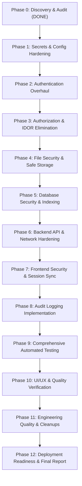

# Metechq Platform — Implementation & Hardening Roadmap

**Date**: November 6, 2026  
**Execution Strategy**: Sequential, Verifiable Phases with Regression Testing  
**Primary Objective**: Secure, Reliable, Maintainable, Production-Ready Platform  

---

## 1. Roadmap Overview & Milestones

---

## 2. Phase-by-Phase Execution Plan

### Phase 1 — Secrets & Configuration Hardening
- **Objectives**:
  - Eliminate all hardcoded fallback secrets (`backend/auth/jwt.py`).
  - Validate mandatory configuration on startup (`MONGODB_URI`, `JWT_SECRET_KEY`, `CORS_ORIGINS`).
  - Prepare a sanitized, comprehensive `.env.example` in root, `backend/`, and `frontend/`.
  - Ensure `.gitignore` covers all variations of `.env` across all subdirectories.
- **Key Files**:
  - `backend/auth/jwt.py`
  - `backend/server.py`
  - `.env.example`, `backend/.env.example`, `frontend/.env.example`
  - `.gitignore`
- **Verification Gate**:
  - Unset `JWT_SECRET_KEY` in test environment; verify backend startup refuses to boot with explicit configuration error.
  - Set valid secure key; verify smooth startup.

---

### Phase 2 — Authentication Hardening
- **Objectives**:
  - Enforce password complexity requirements and BCrypt salt security.
  - Fix default super admin bootstrap (`backend/routes/admins.py:78`) to require environment password or generate a secure one-time token.
  - Implement brute-force tracking / rate limiting on `/admins/login` and `/client/auth/login`.
  - Secure `/auth/register` to prevent unauthenticated creation of administrative users.
- **Key Files**:
  - `backend/auth/password.py`
  - `backend/routes/auth.py`
  - `backend/routes/admins.py`
  - `backend/routes/client_auth.py`
- **Verification Gate**:
  - Attempt unauthenticated call to `/api/auth/register`; assert rejection (`401/403`).
  - Verify admin login and client login with valid and invalid credentials.

---

### Phase 3 — Authorization & IDOR Elimination
- **Objectives**:
  - Attach `Depends(get_current_admin)` across all mutating endpoints currently exposed publicly:
    - `backend/routes/contacts.py` (`/admin/all`, `GET/PATCH/PUT/DELETE /{contact_id}`)
    - `backend/routes/content.py` (`PUT /`)
    - `backend/routes/pages.py` (`PUT /{page_name}`, `POST /`)
    - `backend/routes/projects.py` (`POST /`, `PUT /{id}`, `DELETE /{id}`)
    - `backend/routes/services.py` (`POST /`, `PUT /{id}`, `DELETE /{id}`)
    - `backend/routes/settings.py` (`PUT /`)
  - Fix type mismatch in `backend/routes/credentials.py` where `current_admin.role` crashed on dict.
  - Protect `/chat/user-conversation` against unauthenticated email enumeration.
  - Ensure private projects (`is_private == True`) are filtered from public `GET /projects/{id}` unless requester is authenticated admin.
- **Key Files**:
  - `backend/routes/contacts.py`
  - `backend/routes/content.py`
  - `backend/routes/pages.py`
  - `backend/routes/projects.py`
  - `backend/routes/services.py`
  - `backend/routes/settings.py`
  - `backend/routes/credentials.py`
  - `backend/routes/chat.py`
- **Verification Gate**:
  - Automated test suite asserting `401 Unauthorized` for every protected route when accessed without bearer token.
  - Verify authorized requests succeed with `200 OK`.

---

### Phase 4 — File Security & Safe Storage
- **Objectives**:
  - Create centralized file security module (`backend/utils/file_security.py`):
    - Strict extension whitelist (`.jpg`, `.jpeg`, `.png`, `.webp`, `.pdf`, `.svg`, `.docx`, `.zip`).
    - MIME header and magic byte validation.
    - Maximum file size enforcement (10 MB).
    - Filename sanitization via UUID / safe basename.
    - Path traversal prevention.
  - Replace hardcoded `/app/public/uploads` in `storage.py` with cross-platform configurable `UPLOAD_DIR`.
  - Secure project deliverable uploads in `admin_client_projects.py`.
  - Unlink underlying files on disk upon metadata deletion.
- **Key Files**:
  - `backend/utils/file_security.py` (New)
  - `backend/routes/storage.py`
  - `backend/routes/admin_client_projects.py`
  - `backend/routes/client_projects.py`
- **Verification Gate**:
  - Upload dangerous extensions (`.html`, `.exe`, `.bat`); assert rejection with `400 Bad Request`.
  - Upload valid images/PDFs; assert successful storage and safe retrieval.

---

### Phase 5 — Database Security & Indexing
- **Objectives**:
  - Sanitize regex inputs in `backend/routes/notes.py` using `re.escape()` to prevent ReDoS.
  - Implement database index bootstrap routine in `backend/database.py` for all collections (`id`, `email`, `username`, `slug`, `client_id`, `status`).
  - Introduce safe pagination limits to prevent memory exhaustion on large collections.
- **Key Files**:
  - `backend/routes/notes.py`
  - `backend/database.py`
- **Verification Gate**:
  - Run regex test with special characters in notes search; verify safe literal query.
  - Verify indexes are created in MongoDB.

---

### Phase 6 — Backend API & Network Hardening
- **Objectives**:
  - Enforce explicit security headers (CSP, X-Content-Type-Options, X-Frame-Options, Referrer-Policy) via middleware.
  - Add request rate limiter for sensitive endpoints.
  - Validate and sanitize proxy forwarding headers (`X-Forwarded-Proto`, `X-Forwarded-Host`) only when `TRUST_PROXY=true`.
- **Key Files**:
  - `backend/server.py`
- **Verification Gate**:
  - Inspect response headers using HTTP requests; verify security headers are present.

---

### Phase 7 — Frontend Security & Session Alignment
- **Objectives**:
  - Refactor `frontend/src/services/api.js`:
    - Avoid token collisions: send `admin_token` for `/admin/*` and general endpoints; send `client_token` for `/client/*` endpoints.
    - Intelligent 401 handling: redirect to `/client/login` if currently on a client page, or `/admin/login` if on an admin page.
  - Fix missing `/admin/clients/{clientId}/projects` reference in `clientService.js`.
- **Key Files**:
  - `frontend/src/services/api.js`
  - `frontend/src/services/clientService.js`
- **Verification Gate**:
  - Log in as both client and admin in separate tabs/sessions; verify correct tokens are transmitted and 401 flows redirect appropriately.

---

### Phase 8 — Audit Logging Implementation
- **Objectives**:
  - Build persistent, non-destructive audit logging service (`backend/utils/audit_logger.py`).
  - Log security-critical events:
    - Admin/Client login attempts (success & failure).
    - User/Admin provisioning and deletion.
    - File uploads and deletions.
    - CMS content updates and credential mutations.
  - Ensure zero credential or token logging.
- **Key Files**:
  - `backend/utils/audit_logger.py` (New)
  - `backend/routes/admins.py`, `routes/client_auth.py`, `routes/storage.py`, `routes/admin_client_projects.py`
- **Verification Gate**:
  - Execute sensitive actions; inspect `audit_logs` collection in MongoDB to verify clean structured audit documents.

---

### Phase 9 — Comprehensive Automated Testing
- **Objectives**:
  - Create full automated test suite using `pytest` and `httpx`/`requests` covering:
    - Authentication flows (positive & negative).
    - Role authorization and IDOR prevention.
    - File upload validation (valid vs blocked extensions).
    - Data CRUD operations on public vs admin boundaries.
  - Update test runners and configuration (`pytest.ini`).
- **Key Files**:
  - `tests/backend/test_security.py` (New)
  - `tests/backend/test_api_crud.py` (New)
  - `pytest.ini` (New)
- **Verification Gate**:
  - Run full test suite; verify 100% pass rate.

---

### Phase 10 — UI/UX & Responsive Quality
- **Objectives**:
  - Verify layout responsiveness across desktop, tablet, and mobile viewports.
  - Validate forms, loading states, error toasts, and empty states across client dashboard and admin managers.
- **Key Files**:
  - `frontend/src/pages/ClientDashboard.jsx`
  - `frontend/src/admin/AdminLayout.jsx`
- **Verification Gate**:
  - Verify DOM builds cleanly without console errors or layout breaks.

---

### Phase 11 — Engineering Quality & Housekeeping
- **Objectives**:
  - Clean up dead code, obsolete commented-out lines, and unused imports.
  - Fix linting inconsistencies and formatting.
- **Key Files**:
  - Backend and frontend codebase
- **Verification Gate**:
  - Clean lint check and compile check.

---

### Phase 12 — Deployment Readiness & Final Documentation
- **Objectives**:
  - Fix `backend/Dockerfile` CMD instruction to use `uvicorn server:app`.
  - Create root `docker-compose.yml` for unified local/staging deployment.
  - Update `README.md`, `SECURITY_SETUP.md`, `ARCHITECTURE_SUMMARY.md`, `PRODUCTION_DEPLOYMENT_GUIDE.md`.
  - Author `docs/FINAL_AUDIT_REPORT.md`, `PROMPTS.md`, and `THREATS.md`.
  - Commit all changes and push to `https://github.com/mani1715/Metechq.git`.
- **Verification Gate**:
  - All automated tests passing, working tree clean, repository synced.
